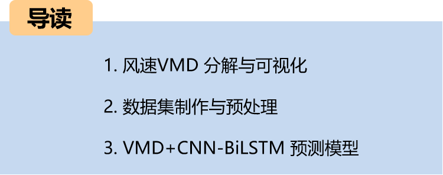
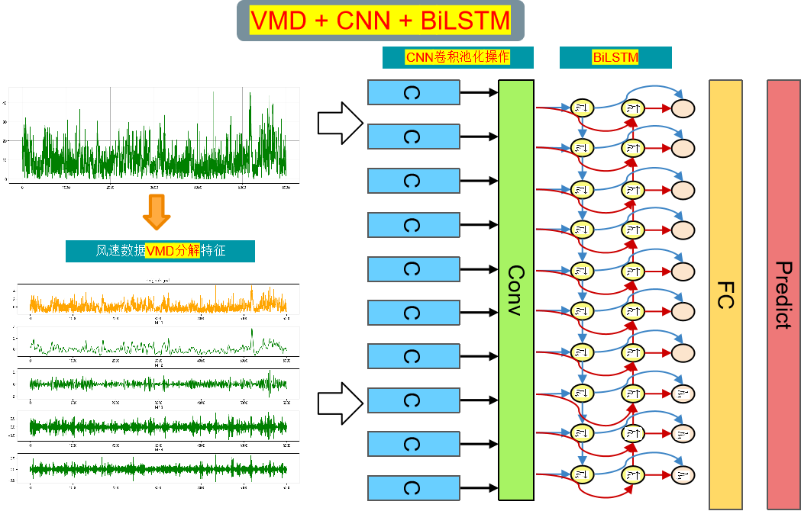
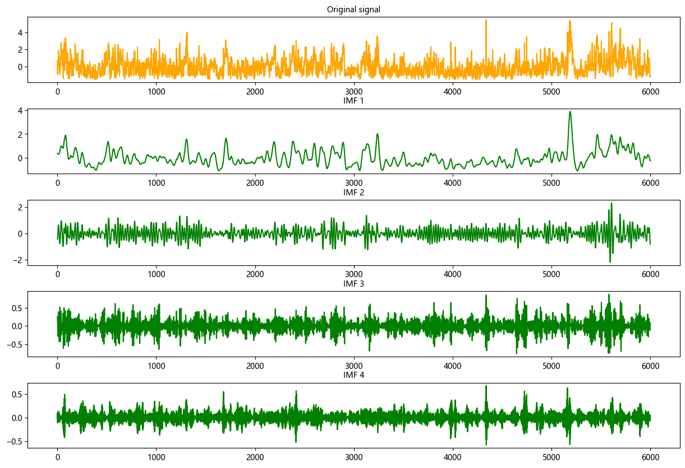
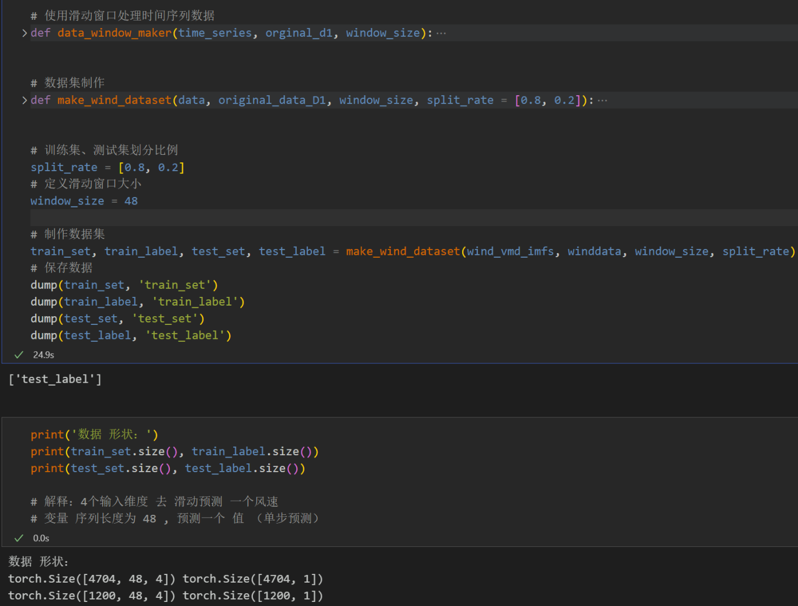
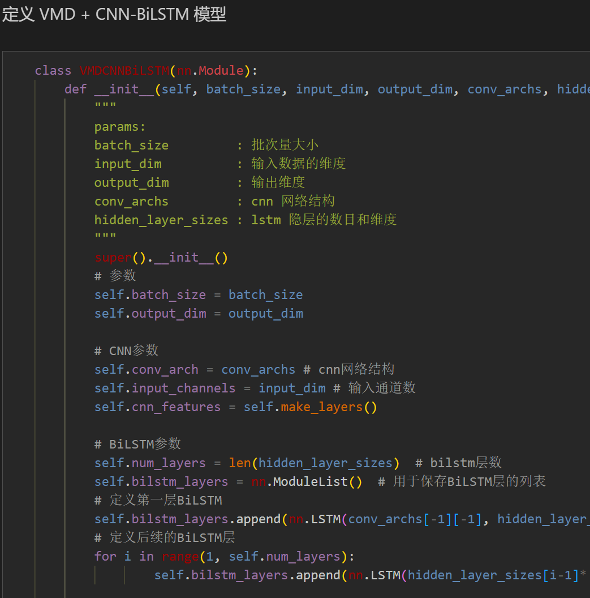
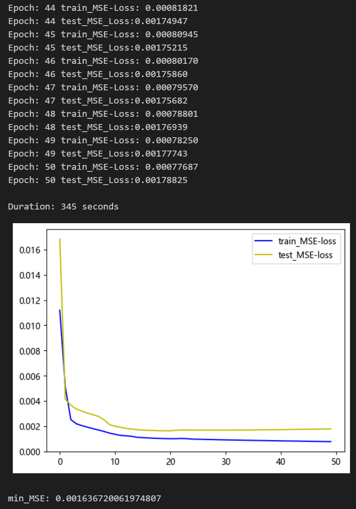
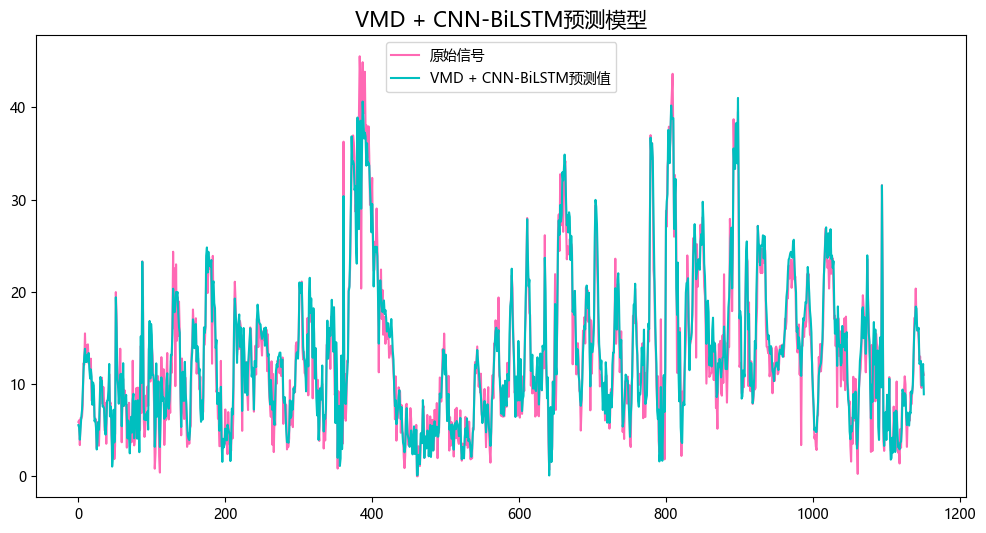
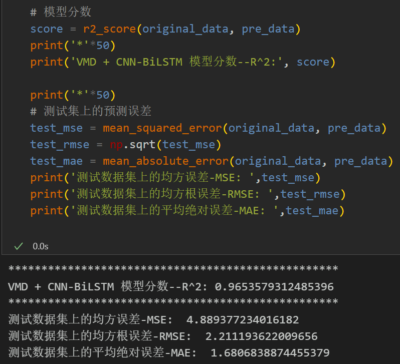
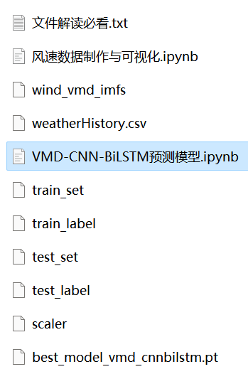

# (Single Step) VMD-CNN-BiLSTM Prediction Model

Multi-feature variables include the following:
Include wind speed data, as well as the already generated and prepared VMD decomposed wind speed dataset and label set. The corresponding code can be run.
VMD-CNN-BiLSTM prediction model, with smaller MSE and MAE, has particularly noticeable effects.
Includes code for data VMD preprocessing, complete VMD-CNN-BiLSTM model prediction code, model evaluation code, and visualization code.
Environment: Python 3.9
Wind Speed Prediction (7) VMD-CNN-BiLSTM Predictive Model
Preface
This article is based on the wind speed data introduced in the previous section (data set attached at the end), which first undergoes VMD decomposition, followed by data preprocessing to create and load the dataset and labels. Finally, a Pytorch-based VMD-CNN-BiLSTM model is implemented to predict wind speed data, aiming to enhance the prediction performance of time series data. For more detailed information about the wind speed dataset, please refer to the following text:
Wind Speed Prediction (Part 1) Data Set Introduction and Preprocessing
The overall structure of the model: The wind speed sequence is decomposed using the VMD algorithm to form a feature input, and a sliding window dataset is created for prediction. Through the CNN-BiLSTM model, features in the component space and time domain are extracted, which are then fed into fully connected layers to achieve a high-precision prediction model.
1. Decomposition and Visualization of VMD
1.1 Import data
1.2 VMD Decomposition
Step 1: Mode selection
Observe the center frequency under different K values, select the K value; Starting from K=4, there are modes with similar center frequencies, indicating overdecomposition. Therefore, the number of modes K is set to 4.
Step two, Visualization of VMD decomposition of wind speed data
\t  
2. Data Set Creation and Preprocessing
\tFirst, divide the dataset into training set and test set according to 8:2 ratio.
When dealing with LSTF issues, selecting the appropriate window size is crucial. The right choice of window size can help the model better capture patterns and features within time series. To extract longer dependencies in the sequence, this paper has increased the window size to 48, employing the VMD-CNN-BiLSTM model to fully extract the feature information from the component sequences.
3. VMD + CNN-BiLSTM Prediction Model Based on Pytorch
3.1 Define the VMD + CNN-BiLSTM prediction model
\tNote: The input wind speed data has a shape of [64, 48, 4], where batch_size=64. 48 represents the sequence length (the values are taken from a sliding window), and the dimension of 4 represents the four components features extracted by VMD.
\t  
3.2 Set parameters and train the model
50 epochs, MSE is 0.001636, the VMD+CNN-BiLSTM model has a good prediction effect. After adding VMD decomposition, the sequence prediction effect is significantly improved, and the performance is superior. By appropriately adjusting the model parameters, it can further improve the model's prediction performance.
\tNote: Adjust parameters.
\tIt is appropriate to increase the number of CNN layers and the dimensionality of hidden layers, and fine-tune the learning rate.
Adjust the number of LSTM layers and dimensions, increase more epochs (note to prevent overfitting).
\tThe sliding window length can be changed (set the appropriate window length).
4 Model Evaluation and Visualization
4.1 Result Visualization
4.2 Model Evaluation
2. Friends who enjoy the content can follow, give the article a "like", share on social media or discuss in groups.

## Images

<!-- PAYMENT_BLOCK -->

## Get this dataset

- Payment link (Stripe): [Buy now](https://buy.stripe.com/3cs8yP7sY87d0vu9AB)
- Payment QR code: 

<!-- /PAYMENT_BLOCK -->
